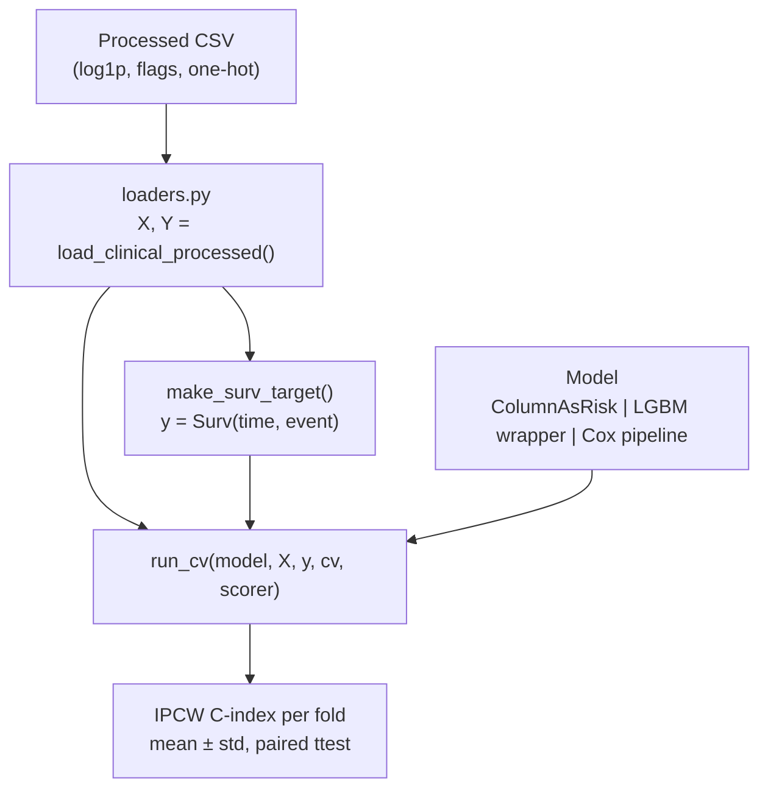

# Leukemia Survival Prediction

> Predicting the risk of death in myeloid leukemia patients from clinical data, using survival analysis with right-censored outcomes.


## Context

This project is my entry for the [QRT Challenge: Leukemia Survival Prediction](https://challengedata.ens.fr/challenges/162) (Data Challenges, ENS). The goal is to predict a `risk_score` for patients with myeloid leukemia: the higher the score, the shorter the expected survival. Performance is measured with the **IPCW C-index** at a **7-year horizon**, implemented with `scikit-survival`.

**Why this is not a standard regression problem:** the outcome is *right-censored*. A patient still alive at their last follow-up (`OS_STATUS = 0`) did not die at that date, so naively fitting a regressor on `OS_YEARS` teaches the model that censored patients died at their censoring time, which biases everything. Survival methods (Cox Proportional Hazards, IPCW C-index, Kaplan-Meier) handle this properly.

Another key property: the C-index only cares about the **ordering** of risk scores, not their scale. Any monotonically increasing transformation of the scores leaves the metric unchanged, unlike the MSE.

This project was carried out as part of the Machine Learning course unit.

## Data

We have 3 datasets at our disposal:
- the target: follow-up duration and status
- the clinical data: the treatment center, various blood parameters, the blast count, as well as the patients' karyotype
- the molecular data: somatic mutations detected in the cancer cells

**Here, we focus on the clinical data for the features dataset.**


## Results

5-fold cross-validation (stratified on the event indicator, identical folds for every model), IPCW C-index at a 7-year horizon.

| Model | Features | IPCW C-index | Notes |
|---|---|---|---|
| Baseline: `BM_BLAST` alone | 1 | 0.610 | No learning, sanity floor |
| Naive LGBM regressor | 6 clinical + `CENTER` one-hot + karyotypes| 0.5997 ± 0.022 | Ignores censoring; heavy overfitting (0.80 train → 0.60 val) |
| Cox Proportional Hazards | 6 clinical + `CENTER` one-hot + karyotypes | 0.6847 ± 0.0278 | Handles censoring; near-zero train/val gap |
| Cox Proportional Hazards | 6 clinical + `CENTER` one-hot + featured engineered karyotypes | 0.6907 ± 0.0259 | no real differences compared to previous model |
| **Cox Elastic Net** | **6 clinical + `CENTER` one-hot + featured engineered karyotypes** | **0.6952 ± 0.0295** | small improvement  |

### What I learned from these numbers

- **Censoring is the central issue.** The naive LGBM benchmark (requiered by the challenge) treats censored patients as if they died at their censoring date. Fixing this with a proper survival model (Cox PH) is worth +0.085 C-index, far more than any feature added afterwards.
- **The value of a feature depends on the (feature × model) pair. Flexibility amplifies whatever is in the target: signal if it is clean, noise if it is biased.
- **Missingness indicators (`_MISSING`) are quasi-MCAR**: unstable coefficients across folds, so they are pruning candidates rather than signal.

## How it works



The pipeline follows one rule: **the `data` layer produces data, `features` shapes columns, `models` consumes `(X, y)` and produces risks, evaluation consumes risks and produces scores.** Notebooks orchestrate; all logic lives in the package.

Leakage control:

- Transformations that estimate a statistic (median imputation, target encoding) are computed **inside each CV fold**, never on the full dataset.
- Deterministic, immutable transformations (log1p, flags, one-hot) are applied once when building the processed CSV.
- Every model, from the one-column baseline to the tuned Cox, goes through the same `run_cv` funnel and the same folds, so comparisons are paired fold by fold.

## Repository structure

```
leukemia-survival-prediction/
├── README.md                  # This file
├── LICENSE                    # MIT
├── environment.yml            # Conda environment
├── pyproject.toml             # Package metadata (pip install -e .)
│
├── data/                      # NEVER committed (challenge license)
│   ├── raw/                   #   Downloaded challenge files
│   └── processed/             #   Model-ready data
│
├── notebooks/                 # The story, in order
│   ├── 01_eda.ipynb           #   Exploration, censoring rate, distributions
│   ├── 02a_preprocessing.ipynb #   log1p, missing flags, cytogenetics flags
│   ├── 03_survival_modeling.ipynb # Baselines, Cox, paired comparisons
│   ├── 04_submissions.ipynb   #   risk_score.csv
│   └── restitution.ipynb      # grading notebook
│
└──src/leukemia/              # The reusable package
    ├── data/                  #   loaders.py: load, contract check, Surv target
    ├── features/              #   preprocessor.py: per-fold imputation
    └── models/                #   evaluation.py, wrappers.py: CV, IPCW C-index
```

## Getting started

1. **Download the data** from the [challenge page](https://challengedata.ens.fr/challenges/162) (free account required) into `data/raw/`. The data is never committed, per the challenge license.

2. **Set up the environment:**

   ```bash
   conda env create -f environment.yml
   conda activate leukemia
   pip install -e .
   ```

3. **Follow the notebooks** in numbered order: each starts with "Objective / What we learn" and ends with an interpretation.

## Next steps

- [ ] Refine cytogenetics encoding: parse ISCN karyotypes into binary features with **pre-registered expected signs** (monosomy 7 / del(7q) → unfavorable; favorable translocations t(8;21), inv(16) → sign flips)
- [ ] Add clinically motivated blood-count ratios (e.g. monocyte fraction, computed as differences in log space)
- [ ] Feature selection: prune quasi-MCAR `_MISSING` indicators, then CoxNet (L1-penalized Cox) for an automatic, reproducible selection
- [ ] Train on the full training set, submit `risk_score.csv`, compare against the challenge's Cox benchmark
- [ ] Experiment more sophisticate way of replacing missing data

## Notes

- Molecular data (somatic mutations) is part of the challenge but **out of scope** for this iteration, for time reasons; the focus is on clinical data and a rigorous survival pipeline.
- Testing data are synthetic data exclusively: the challenge data is private and never enters the test suite.

## License

This project is released under the MIT License. The challenge data is *not* redistributed; see the [challenge terms](https://challengedata.ens.fr/challenges/162).

---

*Built as a learning project on survival analysis, censoring, and rigorous model evaluation. Feedback welcome!*